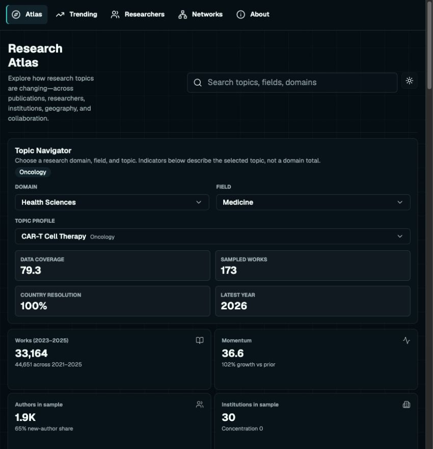
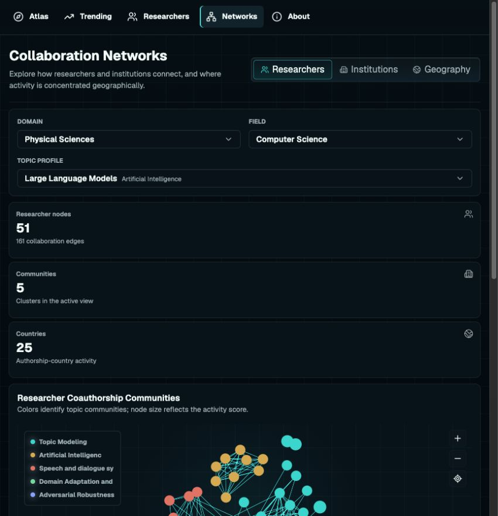
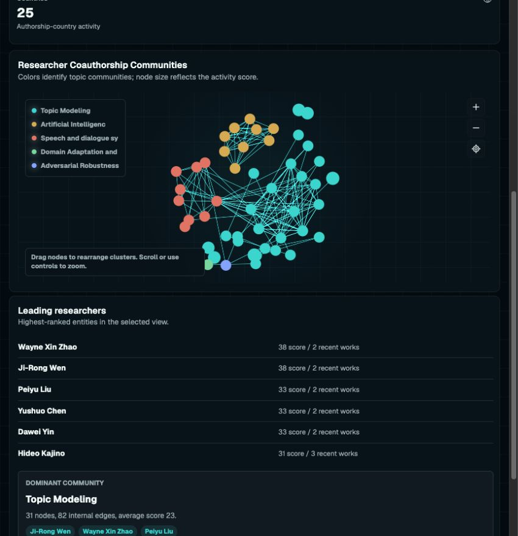
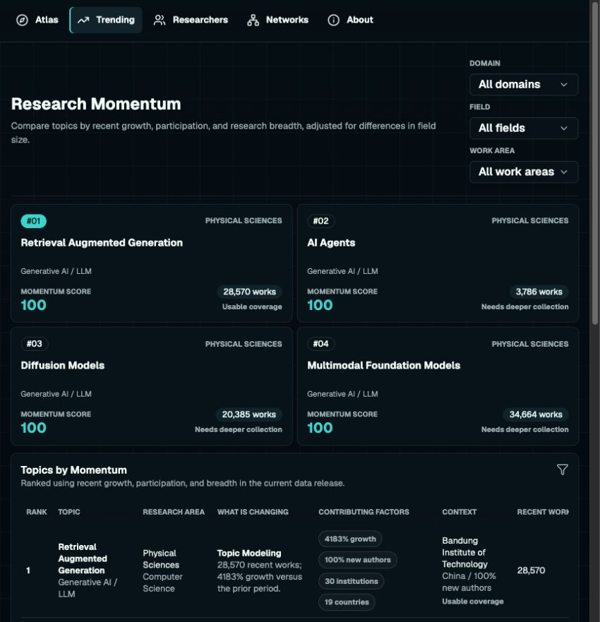
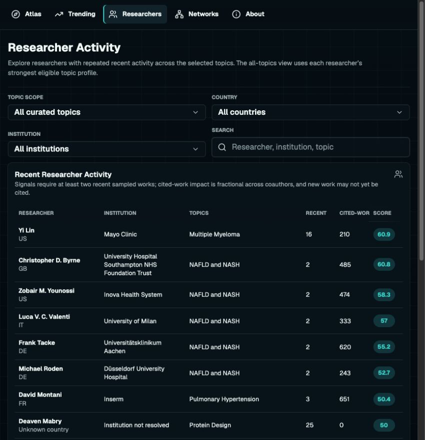

# Research Atlas: assessment and V2 development plan

Assessment date: 7 November 2026. Baseline: `main` at `3e96c22`. Planning branch: `feature/research-atlas-v2-plan`.

## Recommendation

Build a research observatory that helps someone understand how an area developed, discover its important papers and communities, and investigate changes with inspectable evidence. Make the first excellent edition about modern AI: LLMs, agents, retrieval, evaluation, multimodal systems, and safety. Keep the other profiles available as explicitly exploratory coverage; expand depth after the AI edition earns trust.

The signature experience should be a navigable paper landscape with a timeline and a linked evidence panel. Collaboration graphs become a complementary lens. A visually impressive million-point display is a possible later capability, not the success criterion. The success criterion is that a user can explain a real research development and identify the papers supporting it.

This document is an assessment and implementation plan. No application behavior, production data, or deployment workflow was changed for this assessment. The only setup change is an ignored local credential placeholder and its tracked example.

## 1. Verified current state

### Product and operations

- React 19, TypeScript, Vite, Tailwind, Radix primitives, D3, Sigma and Graphology are already present. A framework rewrite is unnecessary.
- The frontend already has shared Select, Tabs, Table, Pagination and layout components. The remaining design problem is composition, hierarchy, task flow and information meaning—not simply missing shared controls.
- Data processing is Python; publication uses GitHub Actions and `gh-pages`. The main branch deploys on push. Both workflows also allow manual dispatch, so merely using a feature branch does not make manually running its deployment workflow safe.
- The September verification run [33835746858](https://github.com/rnepal2/research-atlas/actions/runs/33835746858) succeeded. The eight latest weekly refresh runs checked, September 14–November 2, all report success.
- The [November 2 run](https://github.com/rnepal2/research-atlas/actions/runs/41487844763) collected and validated all 100 topics. The live [index](https://rnepal2.github.io/research-atlas/data/atlas-index.json) reports `generatedAt=2026-11-02T17:21:10.497438+00:00`. Success was checked against the published snapshot, not only the green workflow badge.
- Package version remains `0.0.0`; there is no meaningful product release version. Adopt separately versioned app, schema, corpus definition, and snapshot IDs.

### Coverage observed in the live release

| Measure | Observed value |
|---|---:|
| Configured / published profiles | 100 / 100 |
| Sum of works across profile samples | 5,510 |
| Median sampled works per profile | 49 |
| Range | 4–185 |
| Profiles with fewer than 40 sampled works | 33 |
| LLM sampled works | 110 |
| AI Agents sampled works | 56 |
| Retrieval Augmented Generation sampled works | 69 |
| CAR-T sampled works | 173 |

The sum is **topic memberships, not deduplicated papers**. The corpus can overlap across profiles. Publication totals from aggregate API queries are different populations from these samples: for example, LLMs shows 151,059 matched works in 2023–2025, while its detailed author/network sample contains 110 works across its collection window. Dividing these quantities would not produce a valid completeness percentage.

### What is worth preserving

Useful topic taxonomy, static delivery, independently loaded topic details, year-to-date differentiation, direct paper links, existing data validation, fractional author citation attribution, theme support, and a reusable component foundation. The public application is operational; V2 should improve its evidence and workflows incrementally.

## 2. Current experience: screenshot audit

Captured from the live site in the in-app browser, at its approximately 850×881 viewport. These are current screenshots, not mockups. This is a scoped visual review of four routes plus network detail, not a completed mobile, keyboard, or assistive-technology audit.

### Step 1 — Atlas landing: functioning, weak prioritization

The title and description occupy a narrow column while search takes substantial width. The navigator, coverage tiles and metrics consume the entire first screen before the main trend. A user must configure the site before discovering its value. Coverage score `79.3` looks precise without explaining what it measures. Useful distinction between topic and domain exists in copy, but must become structural.

Change: introduce an informative starting brief; use one compact topic search and breadcrumb; place scope and freshness alongside the title; show the main trend or landscape above secondary diagnostics.

### Step 2 — Network entry: functioning, graph pushed below the fold

At this width the three metric cards stack, consuming much of the viewport. The main graph begins near the bottom. This supports the user's concern about the page organization, despite an existing desktop height calculation.

Change: graph-first viewport, compact inline statistics, collapsible filters, responsive inspector drawer. Keep the graph visible at 1440×900, 1280×800 and 850×881; use a dedicated map/list switch on phones.

### Step 3 — Network detail: visually distinctive, weak orientation

Colored nodes and edges provide a recognisable network, but nodes have no persistent labels, legend names are truncated, and the separate ranking list does not explain why a particular connection matters. The instruction emphasizes dragging nodes rather than investigating research. There is no timeline or visible route from a relationship to its contributing papers.

Change: label meaningful clusters at overview, reveal names with zoom, search and focus a node, inspect edge evidence, and preserve position when changing filters. Selection must synchronize the canvas, list and evidence panel.

### Step 4 — Trending: functioning, ambiguous ranking

Four featured topics all score 100. This removes differentiation. The wide table is clipped at this viewport and dense prose repeats the cards. Large percentages and scores dominate while sample caveats are visually subordinate.

Change: show volume and growth together, expose absolute baseline counts and periods, permit comparisons, suppress unstable small-base claims, and replace saturated scoring with explicit measures and confidence/coverage context.

### Step 5 — Researchers: functioning, needs clearer meaning and drilldown

Filters are reasonably grouped and rows are readable. However, narrow numerical headers collide/truncate, and a single score gives limited evidence for choosing a researcher. Unknown affiliations need deliberate treatment, not visual equivalence with verified affiliations.

Change: clearer metric names, optional columns, stable pagination, selected-row evidence drawer, affiliation dates, supporting works, and saved shortlist/export.

### Accessibility verification still required

Screenshots suggest small-text contrast and truncated-label risks; these are not measured WCAG failures. Verify keyboard navigation, visible focus, contrast in both themes, 200% zoom, screen-reader labels, reduced motion, touch targets and WebGL failure. Every graph action needs an equivalent searchable list action. Never make hover the only way to obtain evidence.

## 3. Correctness and architecture findings

These findings come from code inspection; the proposed corrections are not yet implemented.

| Priority | Finding and evidence | Required correction |
|---|---|---|
| P0 | `build_institutions()` returns only 30 rows; `process_topic()` uses that list for `activeInstitutions` and concentration. Many live profiles consequently show 30. | Calculate metrics over the full eligible set, then limit presentation rows. Test with >30 institutions. |
| P0 | Each institution receives all author IDs on each associated paper in `build_institutions()`. | Count authors from authorships linked to that institution. Keep external collaborators as a separately named measure. |
| P0 | Topic aggregate counts and sampled detail use different eligibility rules. Topic-ID totals can be broad; sample inclusion additionally requires literal query tokens in title/abstract. | Define a versioned corpus membership rule; show aggregate context separately until populations match. |
| P0 | Aggregate yearly search quotes whole query phrases; work collection uses unquoted per-phrase searches plus strict local token matching. | Reconcile query semantics, document recall limitations, and audit a labeled relevance set. |
| P0 | CI does not restore raw data or a durable collector checkpoint; raw files are ignored. Every run starts a fresh small sample. | Persist canonical records and extraction checkpoints outside disposable runners. |
| P0 | Deferred refresh returns success using checked-in processed data; refresh workflow does not restore the newest published snapshot as deploy does. | Explicit `fresh/deferred/failed` outcomes; skip publication on deferred refresh; retain the currently served snapshot; alert with reason and next retry. Test prevention of data rollback. |
| P1 | Bridge betweenness uses collaboration counts as shortest-path distances and silently falls back to degree if NetworkX is absent; only top 180 nodes survive on larger graphs. | Use justified edge distances, e.g. inverse strength; version the algorithm, disclose approximation and graph scope; no silent metric substitution. |
| P1 | Network communities are author topic labels / institution countries, not detected structural communities. | Rename current groupings; compute Leiden/Louvain communities offline if topology is the intended meaning, with reproducible seeds. |
| P1 | Scores and sample-dependent new-author share can imply field-wide prominence or entry. Template text says papers “changed the signal” without snapshot differences. | Use evidence-qualified wording and actual historical observations. No career-entry claims from first appearance in our sample. |
| P1 | Topic trends use completed years; researcher/institution recent activity includes the current year. | Explicit date intervals on every metric and shared period configuration; compare matching elapsed periods for YTD. |
| P1 | Institution/country resolution denominators exclude missing mentions; high resolution can coexist with missing affiliations. | Publish missing-authorship rates and eligible denominators, rather than one composite quality score. |
| P1 | Sample graphs are truncated during processing and again in rendering. Layout runs 170 synchronous ForceAtlas2 iterations; labels are deliberately blank. | Preserve full analytical graphs offline, deliver meaningful levels of detail, precompute stable coordinates and remove layout from the UI thread. |

Primary code: `src/scripts/collect_openalex_data.py`, `src/scripts/process_openalex_data.py`, `src/scripts/refresh_data.py`, `src/analytics/network_metrics.py`, `src/analytics/ranking.py`, `frontend/src/components/IntelligenceNetwork.tsx`, and `.github/workflows/`.

The existing validator is useful for structural integrity and size, but passing it does not establish population completeness, sound attribution, or valid interpretation. Add small, hand-checkable fixture datasets for every P0 finding before changing calculations.

## 4. Product direction and core journeys

Proposed positioning: **Research Atlas — understand how research develops.** Source attribution stays visible in methodology and evidence panels, without appearing in every page heading.

Primary audience: technical researchers, engineers and research-minded readers exploring an unfamiliar area or following a field over time. Portfolio visitors should see the value within one minute.

Recommended information architecture:

1. **Overview:** an editorial research brief, a few substantiated developments, featured topic maps, clear coverage/freshness.
2. **Explore:** the paper landscape with time, topic and evidence filters; switch to citation, collaboration or geography lenses without losing scope.
3. **Compare:** two to four topics or research groups with aligned periods and denominators.
4. **People & institutions:** profiles grounded in eligible works, affiliations and relationships.
5. **Methods & data:** corpus definition, quality, release history and downloadable reproducible evidence.

Topic pages remain shareable deep links. Preserve existing routes through compatibility routing. Global topic/time selection persists across pages; current Atlas → Networks navigation reset from CAR-T to LLM illustrates why this matters.

Three acceptance journeys:

- New reader: open AI Agents → identify three subareas → inspect representative papers → save five papers and export citations.
- Returning reader: compare two releases → distinguish new publications from indexing corrections → open the exact works behind a claim.
- Technical evaluator: open a shared map view → reproduce the metric/filter scope → read the documented methodology and measured performance.

## 5. Signature graph experience

### Two linked representations, with distinct meanings

**Landscape:** one point per paper, positioned by an explicitly documented similarity method. At overview show density and labeled thematic regions; zoom reveals subclusters, papers, then selected-paper context. Proximity indicates modeled similarity, not proof of agreement or a citation edge. Start with citation-derived similarity or TF-IDF/SVD where text permits; evaluate scholarly embeddings as a later controlled improvement. Record missing abstracts and projection/model versions.

**Relationships:** actual citation links, coauthorship or institution collaboration. Let users choose an edge type. Show only selected neighborhoods or aggregated edges at wide zoom. Every selected edge explains its meaning and lists supporting works. Never substitute OpenAlex `related_works` for actual references; add `referenced_works` to the canonical collector schema for citation analyses.

### Interaction specification

- Search a paper, author or concept and smoothly focus it; retain a breadcrumb/back history.
- Click a cluster to inspect its size, date distribution, representative papers and named subareas.
- Brush a timeline, lasso papers, filter by type/year/venue/OA, and compare the selection with the whole eligible corpus.
- Link map, result list and inspector. Inspector provides abstract availability, DOI, affiliations, cited/citing context and inclusion reason.
- Pin two clusters or selections for comparison. Export CSV/BibTeX and copy a URL encoding snapshot, filters, selection and camera.
- Keep positions stable across ordinary filtering. Rebuild layouts only as explicit version changes; anchor/alignment techniques preserve the user's mental map between releases.
- Provide cluster outlines and labels, selected-neighborhood emphasis, visible counts of hidden nodes/edges and a reset button. Reduce ambient grid lines, border glow and always-visible edges.
- Offer a list-first fallback on low-memory devices or when WebGL is unavailable. No mandatory live force simulation.

### Renderer decision

| Candidate | Best role | Decision |
|---|---|---|
| Existing Sigma + Graphology | Focused relationship graphs with picking and neighbors | Retain for first prototype; benchmark larger real fixtures before replacing. |
| deck.gl | Large precomputed point landscape, binary buffers, GPU filtering and linked layers | Preferred landscape prototype; measure bundle and integration cost. |
| Cosmograph | Integrated graph/embedding exploration, timeline and filters | Comparative spike; validate SDK license, integration and measured performance before commitment. |
| Deepscatter | Progressive, tiled multi-million-point landscapes | Architectural reference / alternative; evaluate maintenance and noncommercial licensing before adoption. |

Sigma already uses WebGL; a new renderer alone will not solve the current arbitrary truncation or limited exploration. [Sigma overview](https://www.sigmajs.org/) documents its graph focus. [Cosmograph](https://cosmograph.app/) demonstrates integrated timeline/filter exploration. [Deepscatter](https://github.com/nomic-ai/deepscatter) uses Arrow/quadtree progressive loading and supports static hosting, with a noncommercial license caveat. [deck.gl performance guidance](https://deck.gl/docs/developer-guide/performance) stresses stable buffers, chunking and device memory limitations.

Million-point scatterplots and million-node graphs with all edges are different workloads. The plan must benchmark both point count and edge count; external demos are not evidence that our application will meet their performance.

### Delivery and performance targets

Offline: canonical records → eligible corpus → sparse graph/community computation → deterministic coordinates → multiresolution tiles → snapshot manifest. Browser: lightweight manifest → overview tile → viewport/selection detail, with worker decoding, cancellation, cache bounds and typed arrays. Keep large buffers out of React component state.

Initial measured targets, not current claims: first useful overview within 3 seconds on a documented laptop/network profile; p95 selection feedback below 150 ms after load; ≥45 FPS pan/zoom at 50k visible points; acceptable ≥30 FPS on the agreed lower-end device. Test graph fixtures at 1k/10k/50k nodes with explicit edge densities. Separate 100k/1m-point stress tests from real corpus coverage. Keep initial data transfer under 2 MB compressed, lazy-load the renderer, and measure memory on mobile before setting a final cap. Publish hardware, browser, traces and dataset hashes with results.

## 6. Data strategy: deeper coverage within a free key budget

### Define “complete” before collecting

Begin with a bounded AI corpus, provisionally 2017–present plus an explicitly identified foundational-paper supplement. Include research articles, conference papers and preprints according to a documented policy; group versions without silently collapsing distinct works. Topics overlap: maintain one canonical paper table and a many-to-many topic membership table.

“Complete” means the extraction exhausted every page for a versioned query/time boundary at a recorded date. It does not mean all scholarship in the real-world field. Report expected API match count, retrieved unique IDs, exclusions, missing metadata and audited relevance. Separate query completeness from semantic recall. A time-bounded public snapshot may help initial backfill but is not automatically economical for a small project.

Audit 100–200 candidate works across core subtopics with positive/negative examples, aliases, abbreviations, false positives and missing abstracts. Target ≥90% precision on the labeled set; estimate recall against a curated must-include paper set and document its limitations. Freeze query versions for trend comparisons.

### Durable schema and storage

Use Parquet for durable partitioned data and DuckDB for batch processing; SQLite is sufficient for job/checkpoint state initially. Tables: works, work versions, authors, authorships, affiliations, institutions, references, topic memberships, observation history and extraction jobs. Primary keys derive from OpenAlex IDs; retain DOI and source timestamps. Store citation observations with observation dates so citation changes can actually be measured.

Keep acquisition storage separate from public assets. For the pilot, use a versioned release artifact or suitable object store as durable storage, with checksums and recovery tests; an Actions cache is only an optimization because it can be evicted. At scale use object storage with retention policies and a public artifact CDN. Provider choice waits for size/cost measurements.

### Refresh schedule

- Initial backfill: cursor-paginated, resumable partitions by topic and year, ordered by coverage gaps; bounded daily jobs until complete.
- Two or three times weekly: query recent publication windows with an overlap for late indexing; upsert/deduplicate IDs. This does not catch every older-record correction.
- Weekly: refresh aggregate counts and selected citation/metadata cohorts; validate and publish a coherent release only when required partitions pass.
- Monthly: rotate through older cohorts, reconcile missing/merged/retracted records where available, and rebuild comparisons.
- Quarterly: evaluate a broader reconciliation/backfill and query-definition audit.

True `from_updated_date` / `from_created_date` synchronization is paid Member+/Partner functionality, including corresponding sorts; do not design a free-key pipeline around it. [OpenAlex sync documentation](https://help.openalex.org/access/sync/). Publication-date overlap plus periodic reconciliation is the proposed free-tier approximation, with its freshness limitations disclosed.

As currently documented, a free key has $1/day; list/filter requests cost $0.0001 and searches $0.001. At 100 results/page, 100k matching records cost roughly $0.10 with filters or $1.00 with searches, before retries/overlap. These are capacity estimates, not a promised corpus size or price ceiling. [OpenAlex example costs](https://help.openalex.org/access/example-costs/).

Set a project budget initially at $0.50/day with headroom for the existing production job and the owner's other usage. Read remaining budget before and during work; meter actual response costs; checkpoint before exhaustion. Existing production and feature development may share a key budget even when Git branches are separate. Run backfills away from the production refresh window. Handle quota exhaustion, request-rate limits, transient errors and plan-required responses differently. Current documented rates and new-account pacing should be read at implementation time. [OpenAlex authentication](https://help.openalex.org/api/authentication/).

No API key is needed for this assessment. An empty ignored `.env` is prepared for later local probes. Do not paste the key into chat or prefix it with `VITE_`. Current scripts do not automatically read `.env`; add a deliberate server-side/local loader or export it when collection implementation begins. Production already has a working Actions secret; its value was not read or modified.

## 7. Insights worth building

Replace generic “why this topic is moving” templates with versioned evidence objects: claim, metric definition, corpus version, comparison periods, numerator/denominator, supporting work IDs, limitations and generated timestamp. Wording can be templated initially. Optional AI may help summarize validated evidence later, but cannot invent causal explanations, totals or significance.

| Insight | Calculation / evidence | Guardrail |
|---|---|---|
| Sustained growth vs one-year spike | Annual/monthly volume, absolute change and rolling trend | Same corpus/query version; flag indexing changes and incomplete periods. |
| Themes gaining share | Subtopic fraction within eligible parent corpus | Minimum counts and stable topic assignment; not just raw percentage growth. |
| Emerging collaboration | New cross-cluster edges and contributing papers | Distinguish new to the data from genuinely first collaboration. |
| Foundational and recent influential work | Within-year/type/topic citation comparisons | Citation count is attention, not quality; separate reviews and preprints. |
| Bridge papers | Sparse citation/similarity graph with inspectable neighbors | Define bridge metric and test robustness to sampling/large-team papers. |
| Group specialization | Within-corpus topic shares and overlapping portfolios | Use affiliation-correct attribution and fractional/full-count choices. |
| What changed since last release | Added/updated/removed records and metric deltas | Separate ingestion changes, metadata corrections and publication events. |

Do not label citations divided by publication age as observed citation velocity. Actual velocity needs repeated citation observations. Do not rank researchers across unrelated fields using an opaque common score. Prefer sortable measures, cohort context and evidence, with experimental composites explicitly labeled.

Long-term trend history can come from publication dates immediately; genuine historical snapshot comparisons and citation velocity accumulate after observation storage starts. Backfill cannot reconstruct citation observations that were never recorded.

## 8. Visual system and page redesign

Aim for a quiet research workspace with strong typography, clear hierarchy and deliberate use of color. Retain a distinctive dark option but design light mode equally carefully. Use accent color for selection and meaningful data, not every border.

Define tokens for spacing, type scale, control height (40px desktop default; larger touch targets), tables, surfaces, status and charts. Distinguish route navigation, view tabs and filter chips. Use consistent placement and keyboard behavior, rather than making all three look identical.

Overview should answer a question first; Explore should give the map the viewport; Compare should align axes and periods; People should prioritize evidence and affiliations. Tables need column priorities, sticky headers where useful, stable page sizes, visible result counts, URL-persisted sort/filter state and intentional narrow-screen alternatives. Empty/insufficient data states must explain what is missing without fabricating rankings.

ResearchRabbit is a useful interaction reference for seed-based exploration, history and linked maps/collections; borrow the investigation loop rather than its branding. [November 5 release](https://www.researchrabbit.ai/releases/major-release-2026-11-05). Our differentiator should be time-based, transparent research analysis, not attempting to duplicate every literature-manager feature.

## 9. Phased implementation and release gates

Estimates are focused engineering time for one developer, excluding calendar waits for backfills and user feedback. Plan roughly 7–11 weeks for a strong V2; the first useful vertical slice should land earlier.

| Phase | Deliverables | Gate / acceptance | Estimate |
|---|---|---|---|
| 0 — Trust and isolation | Metric contracts, P0 regression fixtures/fixes, explicit refresh outcomes, production publication guards, version manifest | Hand-calculated totals/attribution agree; deferred refresh never replaces newer public data; feature jobs cannot publish production | 3–5 days |
| 1 — Focused corpus | AI topic definitions, labeled relevance audit, durable storage, resumable collector, budget ledger | Restart mid-partition without loss/duplication; every partition has coverage state; no unqualified completeness claims | 1–2 weeks |
| 2 — Exploration prototype | Compare Sigma/deck.gl prototypes; graph-first shell, linked list/inspector, URL state, one real LLM→agents journey | 3–5 users complete find→explain→save tasks; measured performance; choose renderer by evidence | 1–2 weeks |
| 3 — Useful analysis | Timeline filters, topic comparisons, evidence cards, citation/coauthor lenses, validated export | Every displayed claim traceable; cohort/time tests pass; repeated release produces deterministic artifacts | 1–2 weeks |
| 4 — Full product polish | All routes, responsive layouts, theme parity, empty/error states, accessible alternatives | Keyboard-only completion; contrast checks; 390/850/1280/1440 width tests; no critical UX defects | 1–2 weeks |
| 5 — Portfolio release | Case studies, performance report, methods, demo walkthrough, release notes and rollback rehearsal | Preview acceptance; production promotion explicit; restore previous app/data snapshot successfully | 3–5 days |

### First implementation slice

1. Add focused fixtures for institution counting, affiliation attribution, period definitions and deferred refresh.
2. Separate complete entity aggregates from limited UI lists; publish schema-versioned correct metrics.
3. Guard production publishing by branch/environment, and add CI for feature branches with no production write permission.
4. Add persistent collector state and per-topic coverage manifests for LLMs/Agents/RAG.
5. Build one full-viewport Explore prototype with those real records, a paper list and evidence drawer; then choose the final visual direction.

Do not spend the first phase on a cosmetic rewrite of every page or collecting millions of points before proving one useful journey.

### Measurement

Track task success (find and save relevant papers; explain a trend), time to first useful evidence, relevance audit precision, extraction coverage, metric regression failures, freshness by data cohort, budget per run, p95 interaction latency and exported/shared investigations. Analytics should be privacy-conscious and optional; initial usability sessions and local performance logs are sufficient.

## 10. Deployment boundaries and portfolio value

Work on `feature/research-atlas-v2-plan` and subsequent `feature/*` branches or isolated worktrees. Do not run either existing publishing workflow against a feature ref: they currently push to production `gh-pages`. Future preview builds must use a separate destination and data prefix; production promotion requires a reviewed merge and explicit release decision. Keep production's current weekly schedule during development.

Use immutable `snapshots/<id>/...` assets plus a small manifest, validate hashes/counts/schema before switching the manifest, and retain the previous release. Record `collectedAt`, `processedAt` and `publishedAt` separately. A processed timestamp is not proof of new source data. Test an interrupted upload, stale/missing partition, 429, schema drift and recovery without publishing partial output.

GitHub Actions is viable for scheduled modest data processing; the key missing piece is durable state. GitHub Pages can serve the initial static explorer, but keep large raw corpora separate. Its published-site limit is 1 GB and soft bandwidth limit is 100 GB/month; move public tiles to a suitable object/CDN layer if measured usage requires it. [GitHub Pages limits](https://docs.github.com/en/pages/getting-started-with-github-pages/github-pages-limits).

Portfolio deliverables should include two evidence-led case studies (for example, agents' relationship to retrieval and evaluation), a short exploration walkthrough, reproducible data definitions, a documented quality correction, and real performance benchmarks. Demonstrate product judgment, data engineering and interaction design together. Synthetic stress-test points must be labeled as synthetic, never passed off as research coverage.

## Decisions to revisit after the first slice

- Final core AI scope and historical boundary, using measured corpus counts and query audit results.
- Whether a second deep domain should be oncology or another area of personal expertise.
- Which renderer wins the real interaction benchmark and license review.
- Storage provider only once artifact sizes, transfer and retention costs are measured.
- Whether users need synced accounts; begin with local collections and portable exports.
- Whether paid synchronization or a snapshot backfill produces enough benefit to justify cost. Neither is a prerequisite for the planned pilot.

## Verification limits

This assessment inspected the current repository, deployed index, latest refresh logs and five current screenshots. It did not run a new OpenAlex extraction, spend API credits, reproduce every metric from raw data, run load benchmarks, or perform full accessibility/usability testing. Renderer performance figures in this plan are targets and vendor guidance, not measured results from Research Atlas. Source policies and prices were checked on November 7, 2026 and must be rechecked before a large backfill.
